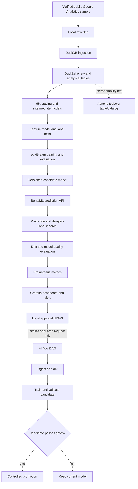

# IMPLEMENTATION_GUIDE.md

## 1. Purpose and execution policy

This guide is the staged engineering plan for the local-first Google Analytics conversion prediction and drift-monitoring proof of concept. Read `CONTEXT.md` first and follow its security, approval, scope and open-source requirements.

**Execution mode:** hybrid. OpenCode should inspect and plan, explain the next stage, implement one approved stage, test it, report evidence, and wait before moving to the next consequential stage. Do not build the whole platform in one unreviewed pass.

**Target environment:** Windows + Docker Desktop, preferably with WSL2 enabled. Keep project files inside the WSL2 Linux filesystem for container-heavy work where practical; Windows-mounted paths can be slower. Validate commands against the user's actual shell.

## 2. Architecture overview



The exact architecture may be adjusted only after a documented compatibility test or a user-approved decision. DuckLake and Iceberg are distinct table formats. Do not call a DuckLake table an Iceberg table or imply that simply installing both extensions makes all catalog operations interchangeable.

## 3. Stage 0 — Inspect repository and validate local prerequisites

### Tasks

1. Inspect current directory, files, Git status, README and existing configuration before writing anything.
2. Check availability and versions of:
   - Git
   - Python (choose a version supported by all pinned libraries)
   - Docker Desktop and Docker Compose
   - WSL2 integration if used
   - OpenCode's repository context/configuration conventions
3. Determine available RAM, disk and CPU where feasible. Keep the initial model CPU-friendly.
4. Create a proposed repository structure and present it for approval.

### Suggested structure

```text
.
├── CONTEXT.md
├── IMPLEMENTATION_GUIDE.md
├── README.md
├── pyproject.toml
├── .python-version                 # if a version manager is used
├── .gitignore
├── .env.example
├── docker-compose.yml
├── config/
│   ├── app.yaml
│   └── drift.yaml
├── data/
│   ├── raw/                        # ignored by Git
│   ├── interim/                    # ignored by Git
│   ├── processed/                  # ignored by Git
│   └── simulated/                  # ignored by Git
├── warehouse/                      # ignored local catalog and table data
├── dbt_project/
│   ├── dbt_project.yml
│   ├── profiles.yml.example
│   ├── models/
│   │   ├── staging/
│   │   ├── intermediate/
│   │   └── features/
│   ├── tests/
│   └── macros/
├── src/
│   └── analytics_ml/
│       ├── ingestion/
│       ├── lakehouse/
│       ├── features/
│       ├── training/
│       ├── monitoring/
│       ├── approval/
│       └── common/
├── services/
│   ├── prediction/
│   └── approval/
├── dags/
├── monitoring/
│   ├── prometheus/
│   └── grafana/
│       ├── provisioning/
│       └── dashboards/
├── tests/
│   ├── unit/
│   ├── integration/
│   └── e2e/
└── reports/                        # generated reports; ignore large artifacts
```

Adapt if the repository already has a sound structure. Avoid creating empty folders without a near-term purpose.

### Acceptance criteria

- Environment/prerequisite report is accurate.
- Proposed directory structure is approved.
- `.gitignore` rules are reviewed before downloading data or generating model artifacts.
- No credentials or local datasets are committed.

## 4. Stage 1 — Find, verify and acquire the dataset without paid GCP queries

### Important constraint

The requested source is:

`bigquery-public-data.google_analytics_sample.ga_sessions_*`

A public BigQuery dataset is not automatically a downloadable static file. Do not run a BigQuery query or use paid GCP resources just to discover the data.

### Investigation order

1. Read official Google documentation describing the sample dataset and its schema/provenance.
2. Search for an official static export, public archive, or well-documented mirror with clear licensing/terms.
3. If considering a third-party mirror, verify publisher/repository history, dataset identity, schema, date coverage, row counts where possible, and any licensing restrictions.
4. Compare candidate sources and present evidence before selecting one.
5. If a one-time BigQuery export appears to be the only viable option, stop and explain required permissions, query/egress considerations and possible charges. Ask for explicit approval before proceeding.
6. Record source URL, retrieval date, license/terms, checksums where possible, file sizes and known limitations.

### Data inspection

- Detect actual file formats and compression.
- Inspect schemas and nested/repeated structures.
- Determine date range, session count, visitor identifiers, traffic source fields, device/geography fields and transaction fields.
- Check duplicate session keys, nulls, malformed timestamps, invalid numeric values and schema inconsistencies.
- Preserve raw source files unchanged; perform normalization into separate outputs.
- Do not log or publish data unnecessarily.

### Acceptance criteria

- Provenance and licensing/terms are recorded.
- The source really matches the intended Google Analytics sample, or the mismatch is explicitly disclosed.
- Ingestion can be repeated without accidental duplicate append.
- Schema and basic quality report are generated from observed data, not guessed.

## 5. Stage 2 — Set up DuckDB, DuckLake and Iceberg

### DuckLake primary path

1. Pin a DuckDB release and compatible DuckLake extension based on official documentation.
2. Create a local DuckLake catalog using a local DuckDB metadata database for the simplest proof of concept, unless the chosen release requires a different documented setup.
3. Store data in local files (typically Parquet) in a dedicated, ignored warehouse directory.
4. Create raw/bronze tables with source metadata and ingestion timestamps.
5. Keep raw data immutable; make transformations reproducible.
6. Verify table persistence across DuckDB process restarts.

### Iceberg interoperability path

1. Decide which operations are actually required: read existing Iceberg tables, write Iceberg tables, or copy/interoperate with DuckLake.
2. Read the current official DuckDB Iceberg documentation for the selected release.
3. Distinguish direct metadata-file scanning (which may be read-only) from catalog-managed Iceberg access. If writes are required, identify and configure a supported Iceberg REST catalog. Do not assume a local metadata JSON path supports writes.
4. Choose the lightest maintained open-source REST catalog that supports the required local workflow, if needed. Verify license, storage/catalog dependencies, Docker compatibility and resource footprint before selecting it.
5. Create a small representative table and test the exact required operations.
6. Verify row counts, schemas, null handling, timestamp semantics and content equality after interoperability operations.
7. Document any limitations or use a supported shallow/deep copy approach as appropriate.

### Decision gate

If “both” can be met with DuckLake as the primary working layer and Iceberg as an interoperability demonstration, prefer that over running two parallel transformation stacks. If the supervisor expects all transformed tables to exist in both formats, confirm that requirement and explain storage/maintenance costs before implementing it.

### Acceptance criteria

- DuckLake create/insert/query/reopen tests pass.
- Iceberg read/write/copy tests pass for the agreed operations, or limitations are explicitly documented.
- Round-trip tests compare schemas and row contents.
- All files and catalogs remain local.
- No claim of full compatibility beyond the tested operations.

## 6. Stage 3 — dbt transformations and data quality

### Adapter and version selection

Use a compatible dbt Core + `dbt-duckdb` path unless current official documentation proves another suitable option. The dbt/DuckDB ecosystem is evolving; do not combine packages based only on old tutorials. Record exact versions and run `dbt --version`, `dbt debug`, and a minimal model build before writing the full project.

Determine whether the chosen adapter can target the DuckLake catalog directly and whether it can target the Iceberg path. If the adapter cannot perform a required operation natively, keep dbt transformations on the primary DuckLake path and implement a clearly isolated, tested export/interoperability step. Do not claim dbt directly supports a catalog without proof.

### Suggested model layers

- `stg_ga_sessions`: normalize source names/types, preserve source IDs and source metadata.
- `stg_transactions` or transaction extraction model: only if transaction details exist and the source schema supports it.
- `int_session_behavior`: derive session-level metrics available at prediction time.
- `fct_session_conversion`: one row per valid session with target label and permitted features.
- Optional dimension/reference models only where useful; do not over-normalize a small sample just for appearance.

### Quality tests

- Unique and non-null session key.
- Valid label domain (binary).
- Non-negative counts and sensible numeric ranges.
- Valid timestamp/date parsing.
- Referential integrity only where keys and relationships truly exist.
- Reconciliation of raw vs transformed session counts, with documented exclusions.
- Tests for label consistency and feature leakage.
- Freshness checks only if ingestion timestamps and a meaningful expected cadence exist.

Use dbt documentation and lineage artifacts. Keep sensitive/local paths out of tracked files; use a local profile or environment-specific configuration.

### Acceptance criteria

- `dbt debug`, `dbt build` and relevant tests pass on the acquired sample.
- Models have descriptions and meaningful column names.
- Exclusions and transformations are documented.
- A clean run produces the same logical results.

## 7. Stage 4 — Define and train purchase-conversion model

### Target and unit of analysis

Use one row per session as the initial prediction unit. Define conversion from observed transaction evidence in the actual dataset. Inspect source fields first; do not assume every nested field is populated or consistently encoded.

### Feature design

Candidate features may include pre-conversion information such as device category, traffic source, geography, browser, operating system, session engagement measures and prior visit/session indicators if the source supports them. Every feature must be justified as available at the moment of prediction.

Exclude:
- The label itself.
- Transaction/revenue fields that reveal the outcome.
- Fields computed using events occurring after the prediction point.
- IDs that let the model memorize sessions/visitors without a valid generalization purpose.
- Any feature whose derivation leaks the target.

### Training protocol

1. Save a dataset snapshot/version and feature schema.
2. Use a reproducible random seed.
3. Choose a time-based or visitor-grouped split if possible; explain why a random split might leak information across repeat visitors or adjacent sessions.
4. Start with a simple baseline such as logistic regression with appropriate categorical/numeric preprocessing.
5. Compare a more complex tree-based model only if it adds meaningful value.
6. Evaluate precision, recall, F1, PR-AUC and ROC-AUC as appropriate; include class prevalence and a confusion matrix at a documented threshold.
7. Consider probability calibration if probability values will be consumed downstream.
8. Save model artifact, feature list, preprocessing pipeline, split details, metrics, timestamp and source-data version.
9. Document limitations: historical sample, selection bias, small or dated sample, and lack of live production labels.

### Acceptance criteria

- Label definition and prediction timing are documented.
- Leakage checks are implemented.
- Baseline metrics are saved and reproducible.
- Model artifact includes preprocessing and feature schema.
- A model report describes intended use and limitations.

## 8. Stage 5 — Build the BentoML prediction API

BentoML supports local HTTP serving for a Service. Confirm the selected BentoML version's API conventions and examples before implementation.

### API behavior

Define the exact request/response schema in code and documentation. A conceptual request may include session features such as device, channel and session counts, but use only the actual trained feature schema.

Example conceptual response:

```json
{
  "prediction": 1,
  "conversion_probability": 0.73,
  "model_version": "candidate-or-approved-version",
  "request_id": "generated-correlation-id"
}
```

This is illustrative, not a hardcoded expected probability.

### Required behavior

- Validate required fields, data types, categorical values and numeric bounds.
- Reject malformed input with a useful 4xx response.
- Handle missing or incompatible model artifacts safely.
- Return model version and correlation ID.
- Log request outcome and latency without storing unnecessary raw request payloads.
- Expose or configure health/readiness behavior supported by the chosen BentoML release.
- Add unit tests for feature preparation and integration tests against the live local service.
- Add a small example client and documented `curl` or Python request.
- Bind to localhost by default for local development.

### Acceptance criteria

- Service starts from documented commands.
- Valid sample request returns schema-correct output.
- Invalid request returns a controlled error.
- Service identifies the model version and does not silently load a missing artifact.

## 9. Stage 6 — Monitoring: data drift, concept drift and metrics

### Reference data

Use the training/reference feature distribution and record its dataset/model version. Monitoring batches must use the same feature definitions and compatible types as training.

### Data drift

1. Choose and document metrics suitable for each feature type, such as distribution tests or distance measures.
2. Evaluate batch data against the reference.
3. Consider minimum sample-size requirements and multiple-feature false positives.
4. Choose thresholds based on baseline behavior and validation; explain trade-offs.
5. Store the evaluation time, dataset/batch ID, reference version, features checked, metrics and drift status.
6. Generate a clearly labeled simulated shift for a deterministic demo.

### Concept drift / model quality

Concept drift is not simply a shift in model predictions. It concerns a changing relationship between inputs and outcomes. Implement delayed-label evaluation:

1. Record prediction ID, prediction timestamp, model version, feature version and prediction.
2. When actual conversion labels become available, join them by a stable key.
3. Compute model-quality metrics over a suitable time window and compare them with a baseline.
4. Mark observations without labels as pending.
5. If the static source does not provide a future-label stream, simulate a delayed-label stream for demonstration and label it as simulated.

### Metrics and Grafana

Use Prometheus metrics for service/operational signals and for bounded-cardinality monitoring summaries. Avoid visitor IDs, session IDs, raw URLs or arbitrary feature values as metric labels.

Candidate metrics:
- prediction request count and error count
- request latency
- current model version as an info metric or equivalent low-cardinality metadata
- number of batches evaluated
- drift evaluation status
- drifted feature count
- model-quality metric values when labels are available
- retraining/approval pipeline state and duration

Use logs/reports for high-cardinality detail; use Prometheus for aggregate metrics. Verify the monitoring library's actual supported exporter or implement a small documented exporter. Do not assume direct integration.

### Grafana alert rules

- Trigger on defined drift or model-quality conditions.
- Include a stable alert identifier and evidence/report link.
- Link to the local approval UI; do not put an automatic retraining command in the alert.
- Distinguish firing, resolved, acknowledged and explicitly approved states.
- Test notification behavior with a simulated alert.

### Acceptance criteria

- Dashboard shows baseline and latest evaluation.
- Simulated feature shift triggers the expected alert.
- No label availability is represented honestly.
- Concept-drift/model-quality reporting uses observed or explicitly simulated labels.
- Metrics use bounded labels and Prometheus can scrape them.

## 10. Stage 7 — Local approval interface and API

Implement the smallest local web interface that makes approval explicit and auditable. FastAPI is a candidate for this control-plane API; it is separate from the BentoML prediction API.

### Suggested interaction

1. Grafana alert includes a link to a local approval detail page.
2. The page shows the alert ID, detected signal, evaluation report, model version, proposed action, and approve/reject controls.
3. Approval requires a deliberate POST decision, not a GET request or mere page load.
4. Store the decision and state transition in a small local database or another durable local store selected after reviewing transaction/concurrency needs.
5. Validate alert ID, expiry, current state, requested DAG allowlist, and idempotency key.
6. Reject duplicate, expired, malformed or already-consumed approvals.
7. Record decision time, decision, reason, relevant model/data versions and the authorized Airflow run ID.
8. Trigger only the pre-approved DAG and validated parameters using the selected Airflow version's supported API or documented mechanism.
9. Return a clear status page and useful errors.

### Security controls

- Bind control API/UI to localhost by default.
- Do not expose a general-purpose arbitrary DAG trigger endpoint.
- Keep any API token in an environment variable, never in source control or in a public link.
- Do not treat a hard-to-guess URL as sufficient authentication by itself.
- Use CSRF protections or an equivalent safe form design for browser-based state-changing requests.
- Use an allowlist of allowed DAG IDs and parameter schemas.
- Protect against repeated clicks and webhook retries.
- Separate alert receipt from human decision and from execution.
- Document that local authentication is suitable only for the single-user POC, not a shared or internet-facing deployment.

### Acceptance criteria

- Alert page can display the correct pending request.
- Reject decision is persisted and starts no retraining.
- Approve decision authorizes only the intended run.
- Duplicate approval cannot start a second unintended run.
- Unauthorized/expired requests fail safely.
- Decision and run history can be audited.

## 11. Stage 8 — Airflow orchestration

Use a pinned official Airflow Docker Compose setup suitable for local learning. Follow the official documentation for the selected Airflow version. The official quick-start is for learning/testing, not production hardening.

### Suggested DAG responsibilities

Keep DAGs modular if that improves testability:

- `data_refresh_and_quality`: validate/download a permitted new batch, ingest, run dbt, and run data-quality tests.
- `drift_evaluation`: load the latest valid feature batch, evaluate drift/model quality, persist reports and publish metrics.
- `approved_retraining`: execute only when the approval service has authorized a specific request.
- Optional `candidate_promotion`: promote only a candidate that passes quality and policy checks.

Avoid duplicate scheduling logic. If one DAG is sufficient for the POC, use one DAG with clear task boundaries instead of needless DAG proliferation.

### Retraining DAG flow

```text
Validate approval request and idempotency
                 |
                 v
Validate input batch and data quality
                 |
                 v
Run dbt models and tests
                 |
                 v
Build training dataset snapshot
                 |
                 v
Train candidate model
                 |
                 v
Evaluate candidate against current model
                 |
                 v
        Candidate passes?
          /          \
        yes           no
         |             |
         v             v
Promote safely    Keep current model
         \             /
          v           v
        Record outcome and notify
```

The DAG must verify the approval record and its specific request ID; a user must not be able to bypass the gate by manually triggering a generic retraining DAG in the Airflow UI. Consider Airflow RBAC and a separate internal DAG/operation. Do not assume a UI pause, sensor state or API behavior without testing the selected version.

### Reliability requirements

- Use retries for transient operations only.
- Make ingestion and transformations idempotent.
- Use explicit timeouts and task-level logs.
- Do not let overlapping runs corrupt local tables or overwrite the serving model.
- Record the approval ID, input batch ID, candidate model version and run ID.
- If training/evaluation fails, leave the current model untouched.
- If model promotion fails, recover to the prior known-good version.
- Ensure a rejected or expired approval cannot be used later.

### Acceptance criteria

- Airflow can run a basic DAG end to end.
- Failed tasks show useful logs and retry only as intended.
- An unapproved run cannot train/promote a model.
- Approved run uses the intended batch and approval record.
- Failed candidate validation keeps the existing model active.

## 12. Stage 9 — Historical reprocessing and simulated new data

The original public dataset is historical and should not be represented as a live feed.

Implement two explicit modes:

### Historical replay

- Re-run ingestion/transformation on the same source or selected historical date ranges.
- Use stable batch IDs and idempotency checks.
- Confirm repeated execution does not duplicate rows.
- Record the source snapshot and processing run.

### Simulated batches

- Generate deterministic batch partitions from held-out historical rows or a clearly documented synthetic transformation.
- Preserve a link to the original records where appropriate.
- Simulate feature drift with controlled changes, for example changing a categorical mix or numeric distribution without changing the true historical data files.
- Simulate delayed labels separately for model-quality/concept-drift evaluation.
- Store simulated records in a separate path/table and mark them with `is_simulated` or equivalent provenance metadata.
- Never mix simulated data into the canonical source dataset without explicit labeling.

### End-to-end demo scenario

1. Start the stack and confirm service health.
2. Load a reference batch and capture baseline features/model metrics.
3. Process a normal simulated batch and confirm no alert (if expected by the configured threshold).
4. Process a shifted batch and confirm the data-drift report and Grafana alert.
5. Open the local approval link and reject; verify that no retraining task starts.
6. Create a separate valid pending request and approve it.
7. Verify the corresponding Airflow run starts once and records its approval ID.
8. Verify data-quality tests, dbt, training and candidate evaluation execute.
9. Force a candidate quality failure and prove the active model is not replaced.
10. Run a successful candidate scenario and verify the documented promotion process.
11. Confirm delayed labels update model-quality metrics, or show a clear “labels pending/unavailable” state.
12. Capture logs/screenshots only if useful and approved; redact secrets and local private paths.

## 13. Stage 10 — Testing plan

### Unit tests

- parsing and schema normalization
- label construction
- feature preparation and leakage exclusions
- prediction input validation
- drift calculation behavior on stable and shifted fixtures
- approval state transitions, expiry and idempotency
- model acceptance/promotion rules

### Integration tests

- DuckDB/DuckLake persistence
- Iceberg operations agreed in Stage 2
- dbt models and tests
- model artifact load and prediction
- Prometheus metrics endpoint and scrape
- Grafana alert configuration/notification path
- approval service integration with the selected Airflow interface

### End-to-end tests

- fresh setup to prediction
- drift alert to rejected approval
- drift alert to approved retraining
- failed candidate rollback/retention of current model
- repeated batch/run idempotency

Do not rely only on mocked tests for the main approval gate. Use at least one integration test against the local running components, with test data and no production-like credentials.

## 14. Stage 11 — Documentation and handover

The project README should include:
- purpose, scope and non-production warning
- architecture diagram
- prerequisites and tested versions
- setup and startup commands
- how to acquire/verify the dataset
- how to run ingestion, dbt, training and tests
- prediction API request example
- how to inspect drift dashboards and trigger the demo alert
- how to approve/reject safely
- how to inspect Airflow run logs
- how model promotion and rollback work
- shutdown and cleanup instructions
- known compatibility limitations and troubleshooting
- dependency/license inventory
- data provenance and model report

Do not create extra artifacts beyond the agreed project scope unless needed and approved. The repository may contain the agreed `CONTEXT.md` and `IMPLEMENTATION_GUIDE.md` plus the code and operational files required by the implementation.

## 15. Current documentation references to verify during implementation

These links are starting points. OpenCode must re-check them and the documentation matching the selected versions.

- DuckDB Iceberg overview: https://duckdb.org/docs/current/core_extensions/iceberg/overview
- DuckDB Iceberg writing support: https://duckdb.org/docs/current/core_extensions/iceberg/writing_to_iceberg
- DuckLake overview: https://duckdb.org/2025/05/27/ducklake
- DuckDB Python client: https://duckdb.org/docs/stable/clients/python/overview
- dbt DuckDB adapter: https://github.com/duckdb/dbt-duckdb
- dbt documentation: https://docs.getdbt.com/
- Apache Airflow Docker Compose guide: https://airflow.apache.org/docs/apache-airflow/stable/howto/docker-compose/index.html
- BentoML services: https://docs.bentoml.com/en/latest/build-with-bentoml/services.html
- Evidently open-source repository/docs: https://github.com/evidentlyai/evidently
- Prometheus documentation: https://prometheus.io/docs/
- Grafana alerting documentation: https://grafana.com/docs/grafana/latest/alerting/
- Google Analytics sample dataset documentation: https://support.google.com/analytics/answer/3437719

## 16. Final acceptance checklist

- [ ] Source provenance and license/terms documented; no paid GCP query was run without approval.
- [ ] Local setup and dependency versions recorded.
- [ ] DuckLake operations tested.
- [ ] Iceberg interoperability operations tested and limitations recorded.
- [ ] dbt builds and quality tests pass.
- [ ] Conversion target and leakage rules documented.
- [ ] Training metrics and model report saved.
- [ ] BentoML prediction API works and is tested.
- [ ] Data drift is detected and visible in Grafana.
- [ ] Concept/model-quality drift is based on labels or honestly marked unavailable/pending.
- [ ] Prometheus scrapes metrics successfully.
- [ ] Grafana alert links to the local approval interface.
- [ ] Rejecting approval prevents retraining.
- [ ] Approving a valid request triggers only the intended Airflow run.
- [ ] Duplicate/expired approvals are rejected.
- [ ] Candidate failure leaves the currently serving model intact.
- [ ] Historical replay and simulated batches are clearly distinguished.
- [ ] Tests, startup, shutdown, cleanup and troubleshooting are documented.
- [ ] No secrets, private data or large generated artifacts are committed.
