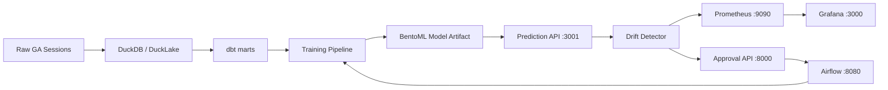

# PROJECT_GUIDE.md

Single source of truth for the local MLOps platform (purchase-conversion prediction).

## 1. High-Level Overview

This repository implements an end-to-end, local-only MLOps platform for a
session-level purchase-conversion model. It covers:

- Data ingestion and transformation (DuckDB + dbt)
- Baseline model training and evaluation
- BentoML prediction serving
- Statistical drift detection (data + concept)
- Prometheus/Grafana monitoring
- Human-in-the-loop retraining approval (FastAPI control plane)
- Airflow-orchestrated, approval-gated retraining and safe promotion

All services bind to `127.0.0.1` only. No cloud egress is required.

## 2. Architecture



## 3. Technology Stack

| Layer | Technology |
|---|---|
| Storage | DuckDB, DuckLake, Iceberg |
| Transformations | dbt |
| Model serving | BentoML |
| Monitoring | Prometheus, Grafana |
| Governance | FastAPI approval control plane |
| Orchestration | Apache Airflow |
| Language | Python 3.12 |

## 4. Runbook

### 4.1 Prerequisites

```powershell
python -m venv .venv
.\.venv\Scripts\pip install -r requirements.lock
```

### 4.2 Start services

```powershell
# Prediction API
.\.venv\Scripts\python -m bentoml serve services.prediction.service:ConversionService --port 3001 --host 127.0.0.1

# Approval control plane
.\.venv\Scripts\python -m uvicorn services.approval.app:app --host 127.0.0.1 --port 8000

# Airflow (docker compose)
docker compose up -d airflow-webserver airflow-scheduler
```

### 4.3 Health checks

```powershell
curl.exe -s http://127.0.0.1:3001/health
curl.exe -s http://127.0.0.1:8000/health
curl.exe -I http://127.0.0.1:8080
```

### 4.4 Tests

```powershell
.\.venv\Scripts\pytest -v
```

### 4.5 End-to-end demo

```powershell
.\.venv\Scripts\python scripts/run_e2e_demo.py
```

## 5. Metrics and Monitoring

- Prometheus scrapes the drift metrics exporter (`:8001/metrics`).
- Key metric: `model_data_drift_detected` (0 = normal, 1 = alert).
- Grafana dashboards visualize drift share, feature-level drift, and model performance.

## 6. Approval and Retraining Workflow

1. Drift detector declares dataset drift.
2. An approval request is created in the control plane.
3. A human operator approves or rejects via the UI/API.
4. On approval, Airflow runs `approved_retraining`.
5. Candidate model is evaluated; on success it is promoted with a backup.

Retraining is never automatic; human authorization is required.

## 7. Known Limitations and Future Roadmap

- Local-only deployment; no cloud scale-out.
- SequentialExecutor for Airflow (not production-grade).
- Concept drift requires delayed labels.
- Future: model registry, automated rollback, richer dashboards.

---
*Generated after successful health checks and end-to-end demo run.*
