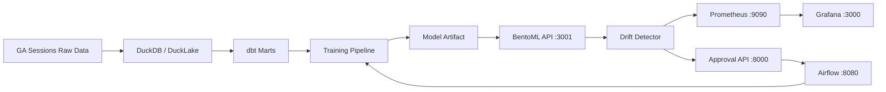

# Local-First Analytics-to-ML Drift Monitoring & Governance Platform

> **Proof of Concept.** A reproducible, local-first data engineering and MLOps platform demonstrating purchase-conversion prediction, covariate & concept drift monitoring, human-in-the-loop retraining governance, and automated Airflow orchestration on the public Google Analytics sample dataset.

---

## 1. Project Overview

This project implements a complete local-first analytics and MLOps workflow:

- Ingest and transform Google Analytics session data with DuckDB + DuckLake + dbt
- Train and evaluate a leakage-safe logistic regression baseline model
- Serve predictions through BentoML
- Detect statistical data drift with KS tests and Jensen-Shannon divergence
- Expose drift metrics to Prometheus and visualize them in Grafana
- Require explicit human approval before retraining
- Execute approved retraining through an Airflow DAG with quality gates and safe model promotion

### Major capabilities

- DuckLake lakehouse storage with Iceberg-compatible local tables
- dbt staging, intermediate, and mart models with tests
- Chronological train/validation/test split
- Baseline logistic regression training and evaluation
- BentoML prediction API
- FastAPI human approval control plane
- Statistical drift detection and Prometheus metrics
- Grafana dashboards and alerting
- Airflow-orchestrated, approval-gated retraining
- Synthetic data generation for drift demonstrations
- 114 automated tests

### Implemented vs future

Implemented:
- End-to-end data pipeline
- Model training, evaluation, serving
- Drift detection and monitoring
- Human approval workflow
- Airflow retraining DAG
- Synthetic drift demonstration

Future improvements:
- Production-grade Airflow executor
- Automated rollback UI
- Model registry
- Richer dashboards
- Cloud deployment

---

## 2. Technology Stack

| Technology | Purpose | Where Used | Why Used |
|---|---|---|---|
| Python 3.12 | Core language | src/, services/, scripts/, tests/ | Required by BentoML and project dependencies |
| DuckDB | Local OLAP engine | src/analytics_ml/training/train.py, lakehouse | Fast local analytics and DuckLake attach |
| DuckLake | Lakehouse catalog | warehouse/ducklake/catalog.duckdb | Local Iceberg-compatible storage |
| dbt + dbt-duckdb | Transformations | dbt_project/ | Staging, intermediate, mart models and tests |
| scikit-learn | ML training/evaluation | src/analytics_ml/training/train.py | Logistic regression baseline |
| BentoML | Model serving | services/prediction/service.py | Local prediction API |
| FastAPI | Approval API/UI backend | services/approval/app.py | Human governance control plane |
| Apache Airflow | Orchestration | dags/approved_retraining_dag.py | Approval-gated retraining |
| Prometheus | Metrics collection | monitoring/prometheus/prometheus.yml | Scrapes drift metrics |
| Grafana | Dashboards/alerts | monitoring/grafana/ | Visual drift monitoring |
| Docker Compose | Container orchestration | docker-compose.yml | Airflow, Prometheus, Grafana |
| pytest | Testing | tests/ | Unit, integration, e2e tests |
| uvicorn | ASGI server | services/approval | FastAPI runtime |

---

## 3. Architecture and End-to-End Workflow



### Execution flow

1. Raw Google Analytics data is stored in DuckLake.
2. dbt builds `fct_session_conversion`.
3. Training script creates a chronological train/validation/test split.
4. Baseline logistic regression is trained and saved.
5. BentoML serves predictions on port 3001.
6. Synthetic batches are evaluated for drift.
7. Drift metrics are exposed on port 8001 and scraped by Prometheus.
8. Grafana visualizes drift and fires alerts.
9. Human operator approves or rejects retraining in the approval API.
10. On approval, Airflow runs `approved_retraining`.
11. Candidate model is trained, evaluated, and promoted if it passes gates.

### Synthetic data demonstration

Synthetic data is used only for demonstration and testing. It simulates normal traffic and mobile-surge drift. It is generated by:

- `src/analytics_ml/monitoring/synthetic_drift.py`
- `generate_normal_batch()` and `generate_shifted_batch()`

Synthetic data is not production data and does not demonstrate concept drift.

---

## 4. Dataset and Data Structure

Source: Google Analytics Sample dataset (`bigquery-public-data.google_analytics_sample.ga_sessions_*`).

Local raw data is stored under `data/raw/ga_sessions/` as quarterly Parquet files. DuckLake stores the lakehouse catalog in `warehouse/ducklake/catalog.duckdb`.

dbt produces:
- `stg_ga_sessions`
- `int_session_behavior`
- `fct_session_conversion` (902,755 deduplicated rows)

Important features:
- channelGrouping
- device_category
- browser
- operating_system
- country
- continent
- traffic_source
- traffic_medium
- visitNumber
- visits
- hits
- pageviews
- time_on_site

Target:
- `conversion_label` (session purchase conversion)

Leakage-prone fields such as transactions and revenue are excluded.

---

## 5. Machine Learning Model

Problem: session-level purchase conversion prediction.

Model: logistic regression with preprocessing pipeline.

Training:
- Training period: 2016-08-01 to 2017-03-31
- Validation: 2017-04-01 to 2017-06-30
- Test holdout: 2017-07-01 to 2017-08-01

Metrics:
- PR-AUC: 0.4026
- ROC-AUC: 0.9838
- F1: 0.3688

Limitations:
- Severe class imbalance (~1.2% prevalence)
- Offline evaluation does not guarantee real-world performance
- Concept drift requires reliable delayed labels

---

## 6. Model Serving and API Documentation

### Services and ports

| Service | Port | Health |
|---|---|---|
| BentoML Prediction API | 3001 | http://127.0.0.1:3001/health |
| Approval API | 8000 | http://127.0.0.1:8000/health |
| Drift Metrics Exporter | 8001 | http://127.0.0.1:8001/metrics |
| Airflow | 8080 | http://127.0.0.1:8080/health |
| Grafana | 3000 | http://127.0.0.1:3000/api/health |
| Prometheus | 9090 | http://127.0.0.1:9090/-/healthy |

### Prediction API

`POST /predict`

Request:
```json
{
  "channelGrouping": "Organic Search",
  "device_category": "desktop",
  "browser": "Chrome",
  "operating_system": "Windows",
  "country": "United States",
  "continent": "Americas",
  "traffic_source": "google",
  "traffic_medium": "organic",
  "visitNumber": 2,
  "visits": 1,
  "hits": 12,
  "pageviews": 8,
  "time_on_site": 240
}
```

### Approval API

| Method | Endpoint | Purpose |
|---|---|---|
| GET | /health | Health check |
| GET | /approvals/pending | List pending approvals |
| GET | /approvals/{approval_id} | Get approval details |
| POST | /approvals/requests | Create approval request |
| POST | /approvals/{approval_id}/decision | Approve or reject |

Swagger UI: http://127.0.0.1:8000/docs

---

## 7. User Interface

- **Airflow UI:** http://127.0.0.1:8080 (admin/admin) — DAG `approved_retraining`
- **Grafana:** http://127.0.0.1:3000 (admin/admin) — drift dashboard
- **Prometheus:** http://127.0.0.1:9090
- **Approval API/Swagger:** http://127.0.0.1:8000/docs

---

## 8. Data Drift, Concept Drift, and Monitoring

Data drift:
- KS test for continuous features
- Jensen-Shannon divergence for categorical features
- Dataset drift declared when ≥30% of features drift

Concept drift:
- Evaluates F1 degradation when labels are available
- Returns `labels_pending` when delayed labels are not available

Metrics exposed:
- `model_data_drift_detected`
- `model_drift_share`
- `model_drifted_features_count`
- `model_feature_drift`
- `model_concept_drift_status`
- `model_batch_f1_score`
- `model_batch_pr_auc_score`

Prometheus scrapes the exporter at `:8001/metrics`.

---

## 9. Manual Approval and Retraining Workflow

1. Drift detector declares dataset drift.
2. Approval request is created.
3. Human operator approves or rejects via API.
4. On approval, Airflow runs `approved_retraining`.
5. Candidate model is evaluated against quality gates.
6. On success, candidate is promoted with backup.

Protections:
- Approvals generate unique `authorized_run_id` tokens.
- Tokens are consumed upon execution.
- Replay attacks are prevented.

---

## 10. Project Folder Structure

```text
MLOps/
├── airflow/                 # Airflow logs (generated)
├── config/                  # Application and drift config
├── dags/                    # Airflow DAGs
├── data/                    # Raw and simulated data
├── dbt_project/             # dbt models and tests
├── models/                  # Model artifacts and metadata
├── monitoring/              # Prometheus and Grafana config
├── notebooks/               # Research notebooks
├── reports/                 # Technical reports and logs
├── scripts/                 # Demo runners
├── services/                # BentoML and FastAPI services
├── src/analytics_ml/        # Core Python package
├── tests/                   # Unit, integration, e2e tests
├── warehouse/               # DuckDB and SQLite databases
├── docker-compose.yml
├── README.md
├── requirements.lock
└── pyproject.toml
```

---

## 11. Installation and Setup

### Prerequisites
- Python 3.12.x
- Docker Desktop with Docker Compose v2
- Git

### Installation
```powershell
cd D:\MLOps
python -m venv .venv
.\.venv\Scripts\Activate.ps1
pip install -e ".[dbt,ml-serving,monitoring,api,dev]"
```

### Environment
Copy `.env.example` to `.env` and adjust values if needed.

---

## 12. How to Run the Project

### Start infrastructure
```powershell
docker compose up -d prometheus grafana airflow-webserver airflow-scheduler
```

### Start BentoML
```powershell
.\.venv\Scripts\python -m bentoml serve services.prediction.service:ConversionService --port 3001 --host 127.0.0.1
```

### Start approval API
```powershell
.\.venv\Scripts\python -m uvicorn services.approval.app:app --host 127.0.0.1 --port 8000
```

### Start metrics exporter (normal state)
```powershell
.\.venv\Scripts\python C:\Users\saksham.dangol\AppData\Local\Temp\opencode\serve_normal.py
```

### Run the end-to-end demo
```powershell
.\.venv\Scripts\python scripts/run_e2e_demo.py
```

### Switch metrics to alert state (Step 3 of demo)
```powershell
.\.venv\Scripts\python C:\Users\saksham.dangol\AppData\Local\Temp\opencode\serve_metrics.py
```

---

## 13. Testing and Troubleshooting

### Run tests
```powershell
.\.venv\Scripts\pytest -v
```

### Common issues
- **Port already in use:** stop the existing process or change the port.
- **Model not found:** run `.\.venv\Scripts\python -m analytics_ml.training.train`
- **Airflow DAG import error:** ensure `analytics_ml` is installed in the Airflow container.
- **No metrics data:** ensure the metrics exporter is running on port 8001.
- **Docker services not starting:** verify Docker Desktop is running.

---

## 14. Limitations and Future Improvements

- Local-only deployment
- SequentialExecutor for Airflow
- Concept drift requires delayed labels
- No production model registry
- No automated rollback UI

---

## 15. Final Notes

This project is a proof of concept for local data engineering and MLOps. It demonstrates the complete lifecycle from data ingestion to monitoring and governed retraining.